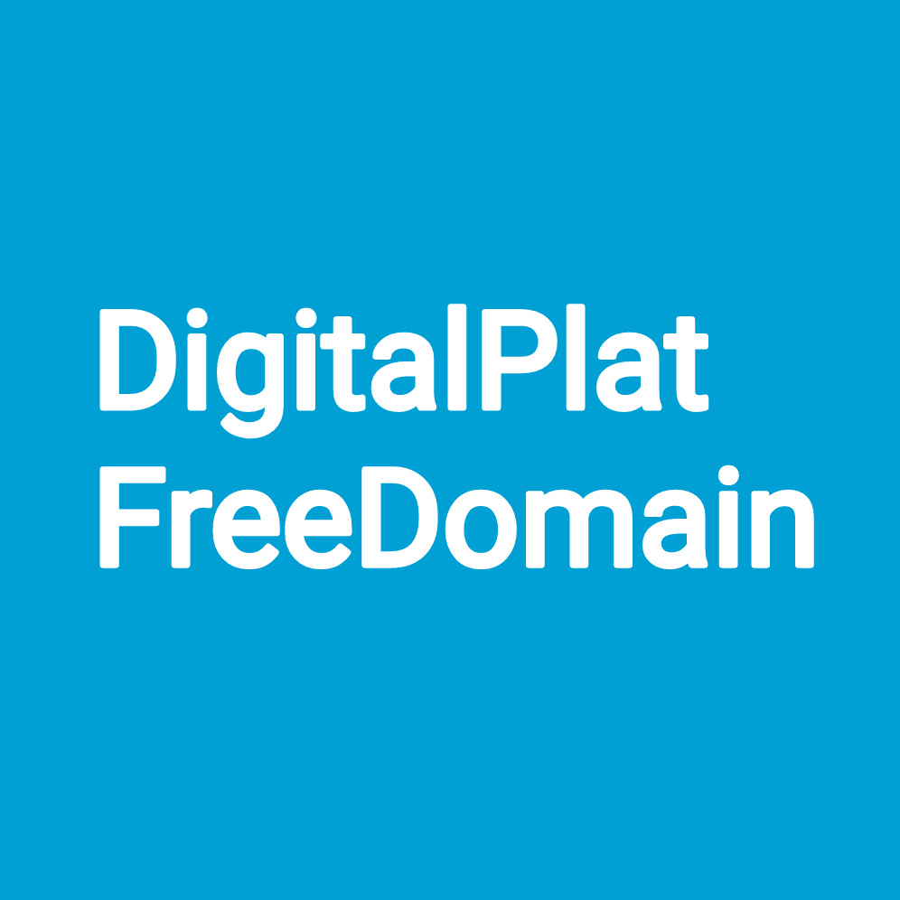

# DigitalPlat FreeDomain

  

Free domain registration and practical DNS learning resources for everyone.

Register a domain, connect your preferred DNS provider through custom nameservers, and use the included learning guide to take a project from registration to deployment.

[Register a domain](https://dash.domain.digitalplat.org/) · [Read the tutorial](./documents/tutorial/index.md) · [Browse the learning guide](./LEARN.md) · [View the application source](https://github.com/DigitalPlatDev/Domain-OSS)

> This repository contains the public information and learning resources for DigitalPlat FreeDomain. The application source code is maintained separately in [DigitalPlatDev/Domain-OSS](https://github.com/DigitalPlatDev/Domain-OSS).

## About This Standalone Edition

- **Main repository:** [DigitalPlatDev/FreeDomain](https://github.com/DigitalPlatDev/FreeDomain)
- **Based on version:** upstream commit `9c7c54110705760267b07b6e6a6d406d1172a1bf` (snapshotted 2026-10-20; upstream HEAD dated 2026-08-12)
- **This edition:** v1.1.0 (v1.0.0 = clean baseline of the upstream version above)
- **What was done:** Converted from a fork into a standalone repository (fresh history, baseline commit), then enhanced in place by Syed Mujtaba Abbas.
- **Enhancements in this edition (v1.1.0):**
  - This About section, with full upstream credit and version provenance
  - `ENHANCEMENTS.md` — per-version changelog of everything changed in this edition
  - `.github/dependabot.yml` — weekly GitHub Actions dependency updates
  - `.markdownlint.json` + `.github/workflows/markdown-check.yml` — markdown linting automation for contributions
  - `.editorconfig` — standard editor settings (UTF-8, LF, 2-space indent)
- **Credit & licence:** All original work belongs to DigitalPlatDev and the upstream contributors. Licence is preserved unchanged — see `LICENSE` (AGPL-3.0). This edition adds the enhancements listed above only.

### ✔️ Why Free Domains?

At **DigitalPlat FreeDomain**, we’re on a mission to make the web more accessible. We believe that the cost of a domain shouldn’t hold anyone back from creating a website. Our goal is to make the internet an open space where everyone can have their own place online, regardless of budget.

> DigitalPlat FreeDomain is independently designed and maintained by [**Edward Hsing**](https://github.com/EdwardLab), founder of the DigitalPlat Foundation.

---

### 🌍 Available Domain Extensions

- **.DPDNS.ORG**
- **.US.KG**
- **.QZZ.IO**
- **.XX.KG**
- **.QD.JE**

_(More extensions coming soon!)_

---

### 🌍 Ready to Claim Your Free Domain?

Jump in and register your domain by visiting our site:

➡️ [DigitalPlat FreeDomain Dashboard](https://dash.domain.digitalplat.org/)

📝 [Read our tutorial](./documents/tutorial/index.md)

---

### 📚 Learning Guide

Follow the complete book-style learning path in [LEARN.md](./LEARN.md), from DigitalPlat FreeDomain setup to general DNS, website, email, operations, and advanced topics.

---

### 🌟 Trusted by Thousands

With over 500,000 domains already registered, DigitalPlat FreeDomain is a trusted choice for individuals and organizations alike. Join our growing community and claim your own free domain today!

---

### ❔ FAQ

Read the [FAQ](./documents/domains/faq.md).

---

### 🤝 Join Our Community!

Join our official [DigitalPlat FreeDomain Discord server](https://discord.gg/ma4RZzMmVW) for updates, support, and project discussions. You can also use [GitHub Discussions](https://github.com/DigitalPlatDev/FreeDomain/discussions) for public questions and ideas.

⚠️ **Security Notice**
Our previous Telegram account and group were compromised and are no longer under our control.
Please **do not trust any messages, links, or announcements** from Telegram, especially anything related to bonuses, earnings, or external sites.
We are no longer using Telegram as an official communication channel.

---

### ⏭️ What's Next?
We might introduce more domain options and free hosting in the future to help as many people as possible! 

**We can’t wait to see what you build!**

---

### 🚨 Abuse Reporting

We take domain name abuse seriously and are committed to maintaining a safer and more open internet. Every report is carefully reviewed, and response times may vary from a few hours to several days, depending on the complexity of the case.

Email: abusereport@digitalplat.org

---

## 🧠 Story

This started as a small DNS experiment when I was 15, letting a few friends use subdomains.

Over time, it grew into something people actually rely on, and running it turned out to be much harder than building it.

I wrote a bit about how it evolved here:  
https://dev.to/edwardhsing/i-bought-a-domain-at-15-now-it-powers-400000-users-7ol

---

## Source Code

The DigitalPlat Domain application is open source at [DigitalPlatDev/Domain-OSS](https://github.com/DigitalPlatDev/Domain-OSS).

Documentation improvements to this repository are welcome. See [CONTRIBUTING.md](./CONTRIBUTING.md) before opening a pull request.
